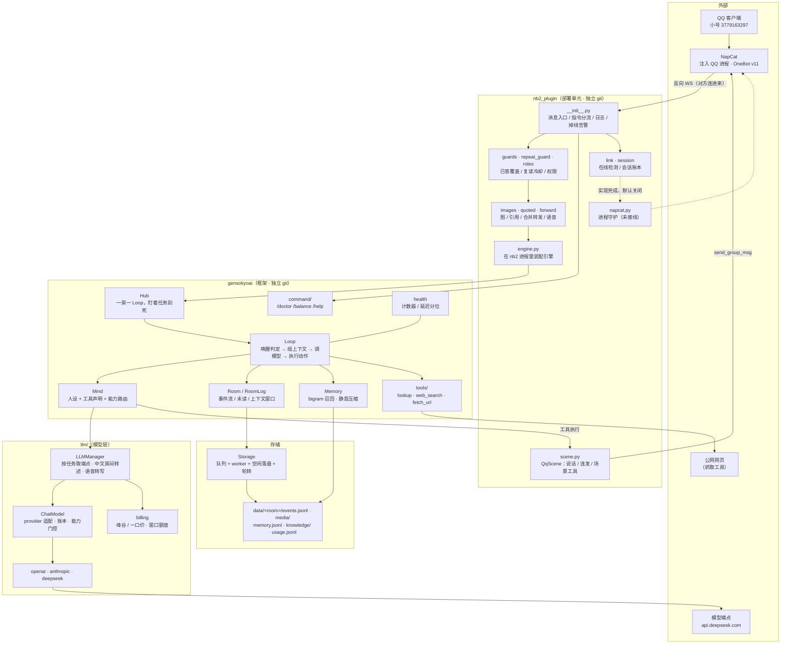
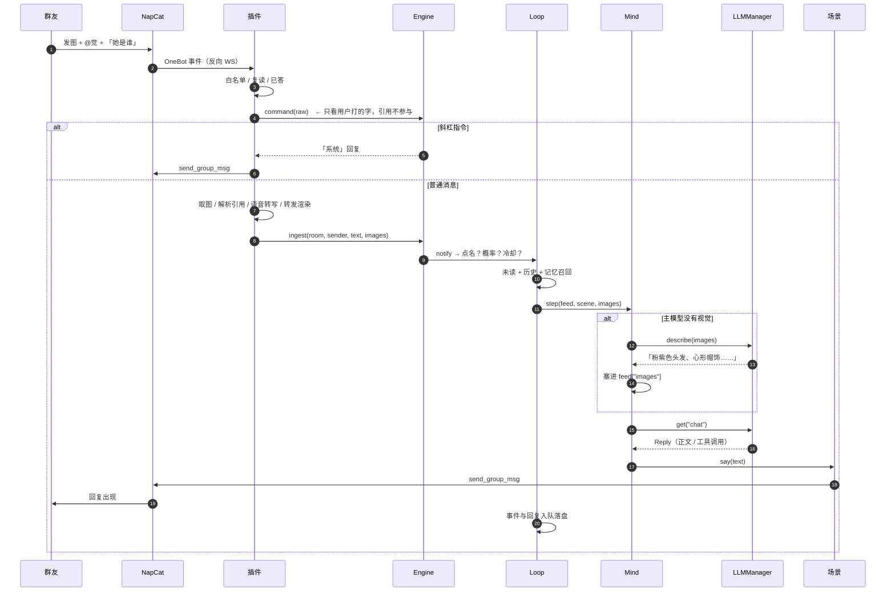
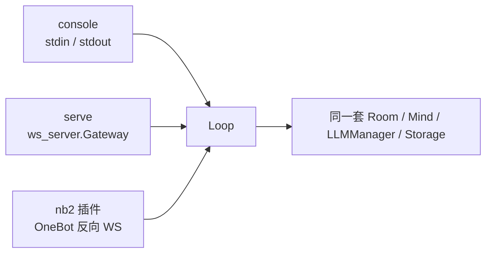

# 整体架构（引擎 + 插件 + 外部）

`architecture.md` 讲的是引擎内核（房间、回合、器官）。这份讲**整套部署**：
消息从 QQ 到模型再回到 QQ，中间经过谁，状态存在哪里。

---

## 一、分层



---

## 二、一条消息的旅程



---

## 三、模块职责

### 引擎

| 模块 | 干什么 | 明确不做 |
|---|---|---|
| `hub.py` | 一房一 `Loop`，任务死了能重启 | 不懂平台 |
| `loop.py` | 一轮编排：唤醒、上下文、重试、说话 | 不懂 QQ |
| `mind.py` | 人设、工具声明、能力路由 | 不碰存储 |
| `room.py` | 事件流、未读、窗口、`RoomLog` | 不调模型 |
| `storage.py` | 追加写 + 队列 + worker + 空闲落盘 | 不懂业务 |
| `memory.py` | 召回与压缩 | — |
| `model.py` | provider 适配、重试、账本、能力门控 | 不做路由 |
| `llm/manager.py` | 任务 → 端点、转述、转写 | 不管单次调用 |
| `llm/bootstrap.py` | 建心智（CLI 与插件共用） | — |
| `command/` | 解析、权限、去重、内置指令 | 不进房 |
| `tools/` | 三层查找、抓网页 | 不懂 QQ |
| `bgtasks.py` | 一次性 / 周期 / 常驻任务 + 收尾 | — |

### 插件

| 模块 | 干什么 |
|---|---|
| `__init__.py` | 消息入口；指令分流；日志落地；掉线告警；启动/收尾 |
| `engine.py` | 装配引擎；`prepare()` 建心智；`transcribe()` 语音转写 |
| `scene.py` | `QqScene`：怎么说话、连发、唤醒参数、`read_member` |
| `images.py` | 取图 / 取语音 / 视频封面；失败留标记 |
| `quoted.py` | 引用（直接用 nb2 填好的 `event.reply`） |
| `forward.py` | 合并转发 → 文字 |
| `repeat_guard.py` / `guards.py` / `roles.py` | 复读冷却 / 已答覆盖 / 权限 |
| `link.py` / `session.py` | 在线状态、告警 / 会话账本（风控样本） |
| `napcat.py` | `bot_exit` → launcher → 等 WS 回连（未接线） |

---

## 四、状态放在哪

```text
config/
  llm/providers.yaml   厂商（base_url、key 从哪读、client_type）
  llm/models.yaml      模型（能力、峰谷价、extra）
  llm/tasks.yaml       chat / vlm / asr / cheap → 模型 id
  llm/billing.yaml     计费窗口
  llm/keys/            key（.gitignore）
  settings.yaml        只剩计费覆盖
  tools/<tool>/sites.yaml   权威站 allow / prefer / block
  roles/<角色>.yaml    人设

nb2_plugin/.env        GSK_* 运行参数

data/
  <room>/events.jsonl  事件流（图只在 media/）
  <room>/media/        最近 60 张
  <room>/memory.jsonl  长期记忆
  knowledge/global.jsonl   查过的资料
  usage.jsonl          计费流水
  link.jsonl           会话账本
  engine.log           引擎格式日志（只收 gensokyoai*）
```

房间名任意，落盘时经 `paths.storage_key()` 转义（非法字符编码、禁止穿越、超长加哈希）。

---

## 五、生命周期

| 东西 | 谁管 | 死了的影响 |
|---|---|---|
| 房间循环 | `Hub`（`add_done_callback` 监督） | 该房静默，下次收消息重启 |
| 引擎后台任务 | `BgTasks` | 退出时按序取消并清理 |
| 存储 worker | `Storage` + `BgTasks.spawn_worker` | 写入故障传给 Future / `sync` / `aclose`，不伪装成功 |
| 静息整理 | `DmnKeeper`（60s 巡逻） | 记忆不压缩，对话照常 |
| 协议端 | 插件 `link.py`（30s 巡检） | 只告警，不自动拉起 |

并发模型：单个事件循环 + 房间隔离；跨房间共享只有模型端点和任务登记处。
`Mind` 为每房派生独立 `PromptCache`，模型端点仍共享；缓存历史、压缩和未读状态不跨房。

---

## 六、四条不变量

1. **平台差异止步于插件**：引擎只认 `text` / `images` / `say`；转发、引用、@、语音全在插件翻译。
2. **能力缺了要降级**：无视觉 → vlm 转述；转述失败 → 当没图；媒体取不到 → 留标记；handler 出错 → 纯文本再入房，且两条路径都先过群白名单。
3. **队列 + 批量落盘**：`write()` 先提交队列，worker 写穿；`sync()` / `aclose()` 等待并报告故障。`flush()` 是 `FlushFileBuffers`（40–120 ms），所以空闲 6 秒或脏 30 秒才刷。
4. **配置只有一处**：模型在 `config/llm/`，`settings.yaml` 只剩计费覆盖、前缀缓存与静息参数。

---

## 七、三种宿主



同一个引擎，三种接法：终端、通用 WS 网关、QQ。插件是最厚的那层适配，引擎不知道 QQ 存在。
